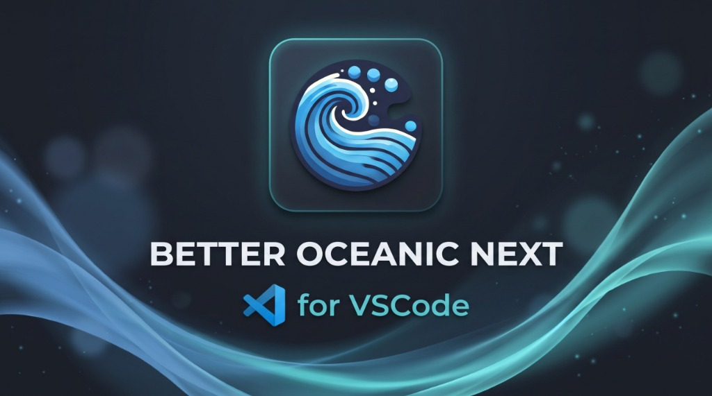

# Better Oceanic Next

A dark Visual Studio Code theme based on **Dainty – Oceanic Next**, featuring refined contrast, vivid diff and merge editor highlights, and clear Git gutter indicators.

## Features

- **Oceanic Next Dark Palette:** Balanced syntax and UI colors built around a calm `#262a30` editor surface.
- **Vivid Git & Diff Highlights:** High-visibility Git gutter indicators (including staged changes), distinct diff line backgrounds, and consistent 3-way merge editor colors.
- **Improved Search & Navigation:** High-contrast find/search match highlights, bordered word highlights, and a clean top-border active tab indicator.

## Installation

1. Open **Extensions** on the sidebar (`Ctrl+Shift+X` / `⌘⇧X`)
2. Search for **Better Oceanic Next**
3. Click **Install**
4. Press `Ctrl+K Ctrl+T` (`⌘K ⌘T` on macOS)
5. Pick **Better Oceanic Next** from the list and hit `Enter`

## JetBrains IDEs

The same theme is also available as a plugin for IntelliJ-based IDEs (IntelliJ IDEA, WebStorm, PhpStorm, DataGrip, PyCharm, GoLand, CLion, Android Studio, Rider, RubyMine, …). See [jetbrains/README.md](jetbrains/README.md) for installation and build instructions.

## License

[MIT](LICENSE.md)
